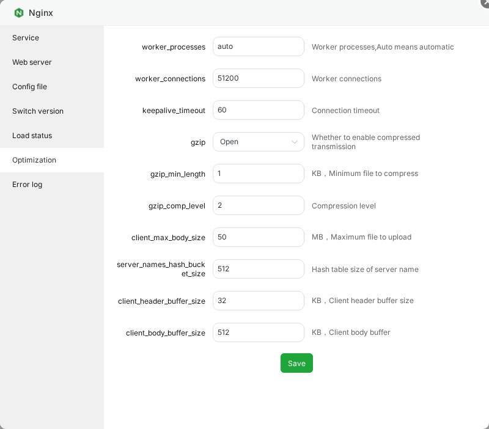

# Authenticated Nginx UI reference study — aaPanel public Demo (2026-11-04)

**Provenance and limits.** This is a directly exercised, authenticated Chromium session on the **official publicly advertised aaPanel Demo** (aaPanel 8.0.7, Nginx 1.24.0), **not** the project's isolated QEMU guest or a screenshot-only reconstruction. The publicly documented demo login was used in the supported real-browser tool. No credentials, login route, cookies, private host IP, raw config, error log, or session identifier are stored here. The browser was set to 1440×900 at 100% zoom. UI elements were opened and measured after their entrance animation settled. No Stop/Restart/Reload/Save/Repair/Switch/Uninstall or other service-changing control was activated.

Screenshot: modal-only JPEG; 800×702 px; SHA-256 `e91a18aee9d2ac5a712b91a799a5cb881cd4ec91ee14a3778baa6039f2249b4d`. No panel chrome, credentials, or raw configuration/log text. The screenshot is a reference artifact, **not an image of the Customizer**.

## Directly observed native geometry

| Feature | Measured result |
| --- | --- |
| Nginx dialog after animation | 800×702 px centered (x320, y99 at 1440×900) |
| Dialog title | 42px tall, 14px font, white background |
| Dialog content | 660px tall, 12px font |
| Left navigation | 170px wide, gray background `rgb(240,240,241)`, 40px row height |
| Selected navigation item | White background, 20px left padding; no bright selected background |
| Active content pane | 630px wide, 16px padding, independently scrollable where needed |
| Optimization field | 150px outer width, 32px height, 10px radius; inner input 134px |
| Optimization row rhythm | Inputs around 52px apart vertically (32px control + 20px separation) |
| Primary Save | 53×32px, 6px corner radius, green `rgb(32,165,58)` (`#20a53a`) |
| Typography | Main content 12px and form labels ~12px; title 14px |
| Responsive 1024×768 | Dialog 800×702px; centered and inside viewport |
| Responsive 900×700 | Dialog 800×672px; height contracts |
| Responsive 768×700 | Dialog 736×672px; left margin 16px; content 566px |
| Responsive 600×660 | Dialog 568×636px; left navigation remains 170px and the form shrinks |

The first instantaneous DOM sample while the dialog was entering showed an intermediate transformed rectangle (~551×483px); this is **not** the steady-state dialog size. DOM classes observed include `n-dialog`, `n-modal`, `n-tabs--left`, `n-tabs-tab--active`, `n-tab-pane`, `n-button` and the fade/scale entrance transition. These are **version-specific implementation observations, not a stable third-party aaPanel plugin API**. Our existing plugin uses aaPanel's native `layui-layer` launcher and must not assume that direct use of undocumented Naive UI internals is supported.

## Actual Nginx tabs and nondestructive interactions

| Sidebar tab (real label) | Read-only inspection | Request observed when entered |
| --- | --- | --- |
| Service | Current service state, Stop/Restart/Reload controls, alert/daemon descriptions | `get_soft_status`, task list, site status |
| Web server | Multi-WebServer Hosting guidance, web-server status table, default service selector | Site request |
| Config file | Ace editor and Save button; config bytes intentionally **not collected** | File request |
| Switch version | Existing Nginx version, Switch button; action **not invoked** | Plugin catalog request |
| Load status | Requests, connections, worker/process and resource table | Load-status request |
| Optimization | Configuration form, explanatory labels, native input and Save geometry | Config request |
| Error log | Read-only log viewer, log selector and scroll; raw log entries **not collected** | Log request |

Navigating among all seven sections kept the **same open dialog**, changed only the active tab and its content, and did not navigate the page. Returning to Web server triggered another site data request. Thus **the fluid transition is a rendering/presentation property, not proof of zero network traffic or built-in caching**. Selected content can scroll independently. The Config editor and Error log viewer have their own long scroll surfaces. Keyboard controls were not comprehensively certified; safe input focus was inspected, but no destructive confirmation dialogs were tested. Request duration was **not benchmarked**: scripted pauses were used to allow rendering. The reference contains working service controls; their effects were not observed or claimed.

## Separate isolated-guest observation, NOT the Nginx reference

The retained Debian 12 / aaPanel 8.0.7 QEMU lab on a Dev loopback forwarded panel has installed Nginx **1.28.3** and installed Customizer **0.1.7**. An already-authorized browser session reached the panel and App Store. Its **Official → Installed** list consistently showed **Total 0** without a Nginx Setting entry; a normal Update App List attempt did not resolve it. The **Third-party Plug-ins** list did show the Customizer and an unrelated *Nginx free firewall* (which must not be confused with the main Nginx manager). Thus **the isolated guest's Nginx management dialog was not inspected** and this gate remains open. No login workaround, raw HTTP credential use, service modification, or guest host-state change was attempted.

The installed Customizer 0.1.7 **was** inspected through its normal Third-party **Setting** action in the authenticated guest. At 1440×900 its `layui-layer` measured 1100×820px, native layer title 42px, sidebar 190px and independently scrolling main area. That already-installed 0.1.7 still presented a redundant inner visible title and tall content; it is **not** the PR #16 candidate with the header correction and optimized controls.

## Gap audit and implementation decisions

| Customizer area | Verified problem / source gap | Bounded PR #16 decision |
| --- | --- | --- |
| Shared shell / navigation | Guest 0.1.7 has 190px sidebar, duplicate inner title; PR16 source had 190px and visual section group labels. Nginx has 170px flat nav and one native title | Retain host-managed layer title, remove duplicate visible title (already in PR16); use simple 170px flat navigation, 40px rows, native gray/white selected contrast, keyboard-focus indication |
| Overview / Monitor | Existing large prose/notes compete with status and three controls; actual guest panel has Monitor controls and text. Native Nginx Service is compact | Use coherent scoped typography and padding, preserve explanatory capability restrictions and read-only status; no change to Monitor authorization or defaults |
| Websites / local Hosts | Dynamic list is real aaPanel data, unlike static Nginx config forms; PR13 introduces read-only Hosts | Keep table pagination, clear state/Refresh and stable native-site identity checks; compact table controls; do not merge PR13 source into unrelated UI PR |
| PHP-FPM / installed versions | Requires guard/recovery/approval semantics stronger than Nginx Optimization's simple Save. PR15 inventory is pending and reload-on-return may affect selector | Retain explicit Prepare/Apply/Restore and stale-preview protection; style controls consistently; reconcile PR15's tab reentry refresh in a later exact combined candidate |
| Status Pages | Long multi-field branding form and offline iframe; unsaved values must persist | Maintain independent content scrolling, reversible preview, unsaved form retention, scoped visual spacing and explicit Refresh/Recheck |
| Activity / Diagnostics | Structured read-only table/filter and sensitive operational details | Retain text-only output, filters, empty/errors and activity refresh while matching native table/control density |

**Implementation choices from observed reference, not assertions of official compatibility:** use `#20a53a` primary color, `#f0f0f1` sidebar, 170px navigation, 40px rows, 32px standard controls, ~10px input radius, 6px button radius, one title and a ~16–20px content inset. Keep the Customizer's default font **13px**, modestly larger than the Demo's 12px, for readability. Retain a 980×760px maximum modal instead of blindly forcing Nginx's 800×702px because Customizer has longer shared-service safety workflows and a preview iframe. These are **deliberate deviations** with responsive overflow checks, not pixel-identical imitation. Preserve the shipped `layui-layer` integration rather than depending on undocumented Naive UI internals.

Data retention on tab return and explicit Refresh (already introduced in PR16) are preferable to copying Nginx's observed re-fetch on each visit. Do not silently approve stale PHP-FPM plans; source tests and exact native integration gates remain authoritative for mutations.

## Open gates / next exact acceptance

1. The **project QEMU guest Nginx UI** must still become accessible via a supported authenticated App Store native route, or the Owner must explicitly accept the public Demo as the reference substitute. Do not mislabel this study as QEMU Nginx acceptance.
2. **Guest UI browser checkpoint passed (bounded):** refined PR16 local ZIP was installed via native file-picker and its actual tab rendering, five viewport sizes, unsaved branding, keyboard tab focus, request caching and synthetic inventory 503/retry were verified; see [guest QA](aaPanel-8.0.7-2026-11-04-native-ui-pr16-qa.md). Full restricted-role, service mutation, independent installed-file digest, extended accessibility and native guest Nginx inspection remain unverified.
3. Reconcile independent PR13 and PR15 `index.html` changes without loss of read-only Hosts or version-safety semantics; the local-only combined rehearsal is not a reviewed integration candidate.
4. Run exact-source tests, Chromium and GitHub CI; obtain an independent HIGH_ASSURANCE review for the actual final diff. No merge, release, or Production changes without Owner approval.

Related: [Issue #17](https://github.com/AChWorks/ach-aapanel-customizer/issues/17), [PR #16](https://github.com/AChWorks/ach-aapanel-customizer/pull/16), [PR #13](https://github.com/AChWorks/ach-aapanel-customizer/pull/13), [PR #15](https://github.com/AChWorks/ach-aapanel-customizer/pull/15).
